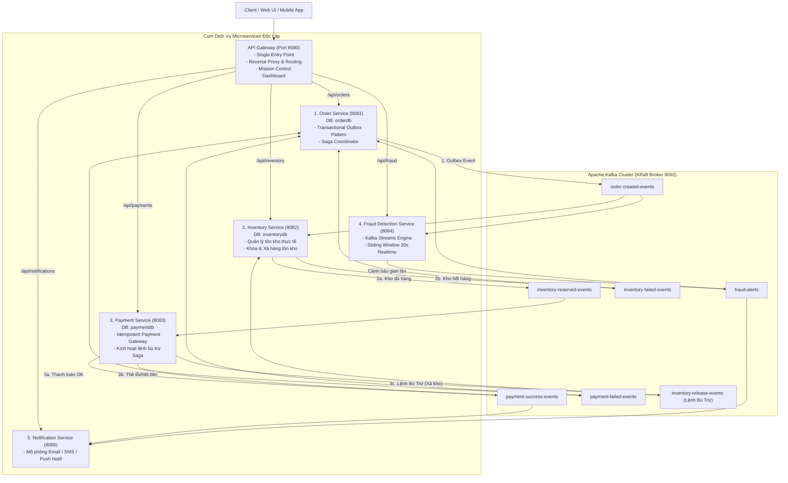

# 🛒 Hệ Thống E-Commerce Event-Driven Microservices Với Apache Kafka (v2.0)

Chào mừng bạn đến với dự án **Hệ Thống Thương Mại Điện Tử Phân Tán (Event-Driven Microservices Architecture)** chuẩn doanh nghiệp, được xây dựng theo mô hình **Maven Multi-Module**, **Choreography-based Saga Pattern**, **Transactional Outbox**, **Idempotent Consumer**, **Kafka Streams Real-time Analytics**, và **API Gateway**.

---

## 🏛️ 1. Sơ Đồ Kiến Trúc Microservices (Architecture Diagram)



---

## 💎 2. Các Kỹ Thuật Đỉnh Cao Trong Phiên Bản Microservices v2.0

| Kỹ thuật / Pattern | Vấn đề trong thực tế | Giải pháp thực tế trong project v2.0 |
| :--- | :--- | :--- |
| **Database-per-Service** | Chia sẻ database gây phụ thuộc chặt chẽ, không thể scale độc lập. | Mỗi Microservice sở hữu Database riêng biệt (`orderdb`, `inventorydb`, `paymentdb`). Không service nào được truy cập DB của service khác. |
| **Choreography Saga Pattern** | Giao dịch phân tán giữa nhiều service không thể dùng `@Transactional` ACID truyền thống. | Phối hợp qua chuỗi sự kiện Kafka: Order $\rightarrow$ Inventory $\rightarrow$ Payment $\rightarrow$ Notification. |
| **Saga Compensation (Bù Trừ)** | Khi thanh toán thất bại, số lượng hàng đã giữ trong kho sẽ bị treo vĩnh viễn. | `PaymentService` tự động phát sinh lệnh `InventoryReleaseCommand` sang topic `inventory-release-events` để kho tự động hoàn trả số lượng. |
| **Transactional Outbox Pattern** | Đặt hàng thành công nhưng broker Kafka mất mạng $\rightarrow$ Mất dữ liệu (*Dual-Write*). | `OrderService` lưu Order và Outbox Event vào **cùng 1 SQL Transaction**. Outbox Publisher quét và đẩy Kafka với xác nhận ACK đồng bộ (`.get(5s)`). |
| **Idempotent Consumer** | Kafka retry khi mất kết nối mạng có thể gây trừ tiền hoặc trừ kho 2 lần. | Bảng `processed_events` trong mỗi service lưu `eventId`. Nếu nhận lại bản tin cũ, Consumer lập tức bỏ qua. |
| **Kafka Streams (Windowing)** | Phân tích gian lận thời gian thực với khối lượng dữ liệu dòng chảy lớn. | `FraudDetectionService` chạy độc lập với Kafka Streams Sliding Window 30s gom nhóm theo `customerId`. Phát hiện $\ge 3$ đơn/30s hoặc tổng tiền $\ge 50$ triệu. |
| **API Gateway & Mission Control UI** | Client phải nhớ quá nhiều port của từng service. | `api-gateway` (Port 8080) là Single Entry Point, định tuyến traffic và phục vụ giao diện Web Dashboard quản trị trực quan. |

---

## 📁 3. Cấu Trúc Dự Án (Maven Multi-Module)

```
kafka-ecommerce-eventdriven/
├── pom.xml                               # Root POM quản lý BOM, version và modules
├── docker-compose.yml                    # Cụm Apache Kafka KRaft + Kafka UI
├── README.md                             # Tài liệu hướng dẫn toàn diện
├── common-contracts/                     # Module chia sẻ Event DTOs & Constants
│   ├── pom.xml
│   └── src/main/java/com/ecommerce/common/
│       ├── constant/KafkaTopicConstants.java
│       └── event/                        # OrderCreatedEvent, InventoryReservedEvent, PaymentSuccessEvent, ...
├── order-service/                        # Service quản lý đơn hàng & Transactional Outbox (Port 8081)
│   ├── pom.xml
│   └── src/main/java/com/ecommerce/order/
├── inventory-service/                    # Service quản lý kho & Saga Compensation (Port 8082)
│   ├── pom.xml
│   └── src/main/java/com/ecommerce/inventory/
├── payment-service/                      # Service thanh toán & Idempotency Guard (Port 8083)
│   ├── pom.xml
│   └── src/main/java/com/ecommerce/payment/
├── fraud-detection-service/              # Kafka Streams Engine độc lập phân tích gian lận (Port 8084)
│   ├── pom.xml
│   └── src/main/java/com/ecommerce/fraud/
├── notification-service/                 # Service gửi thông báo Email/SMS khách hàng (Port 8085)
│   ├── pom.xml
│   └── src/main/java/com/ecommerce/notification/
└── api-gateway/                          # Cổng Gateway & Web Mission Control Dashboard (Port 8080)
    ├── pom.xml
    └── src/main/resources/static/index.html
```

---

## 🚀 4. Hướng Dẫn Khởi Chạy

### Bước 1: Khởi động Apache Kafka Broker & Kafka UI bằng Docker
```powershell
docker compose up -d
```
- **Kafka Broker**: `localhost:9092`
- **Kafka UI**: [http://localhost:8085](http://localhost:8085)

### Bước 2: Build & Chạy Kiểm Thử Tự Động (Maven)
```powershell
.\mvnw.cmd test
```
Toàn bộ các test case kiểm tra Transactional Outbox, Idempotent Consumer, và Saga Compensating Stock Release sẽ được thực thi trên cả cụm modules.

### Bước 3: Khởi Động Các Microservices
Mở từng cửa sổ PowerShell (hoặc chạy trong IDE) và khởi động các service:

```powershell
# 1. Order Service (Port 8081)
.\mvnw.cmd spring-boot:run -pl order-service

# 2. Inventory Service (Port 8082)
.\mvnw.cmd spring-boot:run -pl inventory-service

# 3. Payment Service (Port 8083)
.\mvnw.cmd spring-boot:run -pl payment-service

# 4. Fraud Detection Service (Port 8084)
.\mvnw.cmd spring-boot:run -pl fraud-detection-service

# 5. Notification Service (Port 8085)
.\mvnw.cmd spring-boot:run -pl notification-service

# 6. API Gateway & Dashboard (Port 8080)
.\mvnw.cmd spring-boot:run -pl api-gateway
```

---

## 🖥️ 5. Các Cổng Truy Cập Hệ Thống

| Microservice | Port | URL Truy Cập | Mục Đích |
| :--- | :---: | :--- | :--- |
| 🌐 **API Gateway & Web Dashboard** | `8080` | [http://localhost:8080](http://localhost:8080) | **Giao diện Mission Control chính**, điều khiển kịch bản 1-click |
| 🛍️ **Order Service** | `8081` | [http://localhost:8081/swagger-ui.html](http://localhost:8081/swagger-ui.html) | Quản lý Đơn hàng & Transactional Outbox |
| 📦 **Inventory Service** | `8082` | [http://localhost:8082/swagger-ui.html](http://localhost:8082/swagger-ui.html) | Quản lý Tồn kho & Xả kho bù trừ |
| 💳 **Payment Service** | `8083` | [http://localhost:8083/swagger-ui.html](http://localhost:8083/swagger-ui.html) | Quản lý Thanh toán & Giao dịch |
| 🌊 **Fraud Detection Service** | `8084` | [http://localhost:8084/swagger-ui.html](http://localhost:8084/swagger-ui.html) | Kafka Streams Engine phân tích gian lận 30s |
| 📩 **Notification Service** | `8085` | [http://localhost:8085/swagger-ui.html](http://localhost:8085/swagger-ui.html) | Thông báo Email/SMS khách hàng |
| 📊 **Kafka UI Cluster** | `8085` | [http://localhost:8085](http://localhost:8085) | Giám sát Topics, Consumer Groups, Partitions, Offsets |

---

## 🧪 6. Các Kịch Bản Thử Nghiệm Saga Thực Chiến (1-Click trên Web UI)

Truy cập **[http://localhost:8080](http://localhost:8080)** để bấm trực tiếp các nút thử nghiệm kịch bản:

### 🟢 Kịch bản 1: Happy Path Saga (Đặt hàng thành công trọn vẹn)
- **Hành động**: Đặt đơn hàng MacBook Pro (45.000.000 VND).
- **Luồng sự kiện**:
  1. `order-service`: Lưu đơn (`PENDING`) $\rightarrow$ Outbox Worker đẩy `OrderCreatedEvent`.
  2. `inventory-service`: Nhận event $\rightarrow$ Giữ 1 máy trong kho $\rightarrow$ Phát sinh `InventoryReservedEvent`.
  3. `payment-service`: Nhận event $\rightarrow$ Trừ tiền thành công $\rightarrow$ Phát sinh `PaymentSuccessEvent`.
  4. `order-service`: Nhận `PaymentSuccessEvent` $\rightarrow$ Cập nhật đơn thành `CONFIRMED`.
  5. `notification-service`: Nhận event $\rightarrow$ Gửi Email hóa đơn cho khách.

---

### 🔴 Kịch bản 2: Kho Hết Hàng (Inventory Failure)
- **Hành động**: Đặt đơn hàng sản phẩm `FAIL_INVENTORY_PRODUCT` (Tồn kho = 0).
- **Luồng sự kiện**:
  1. `order-service`: Lưu đơn $\rightarrow$ Phát sinh `OrderCreatedEvent`.
  2. `inventory-service`: Kiểm tra kho thấy số lượng = 0 $\rightarrow$ Bắn `InventoryFailedEvent`.
  3. `order-service`: Cập nhật đơn thành `FAILED_OUT_OF_STOCK`.
  4. Không gọi sang `payment-service` (tiết kiệm chi phí giao dịch).
  5. `notification-service`: Gửi thông báo hết hàng cho khách.

---

### 🟡 Kịch bản 3: Saga Compensating Rollback (Thanh toán lỗi $\rightarrow$ Bù trừ xả kho)
- **Hành động**: Đặt đơn hàng với tài khoản `FAIL_PAYMENT_USER` (Thẻ bị từ chối).
- **Luồng sự kiện**:
  1. `order-service`: Tạo đơn hàng $\rightarrow$ Phát sinh `OrderCreatedEvent`.
  2. `inventory-service`: Đủ hàng $\rightarrow$ Khóa 1 sản phẩm trong kho $\rightarrow$ Bắn `InventoryReservedEvent`.
  3. `payment-service`: Cổng thanh toán từ chối thẻ $\rightarrow$ Ghi nhận thanh toán `FAILED`.
  4. **KÍCH HOẠT LỆNH BÙ TRỪ SAGA**: `payment-service` bắn `InventoryReleaseCommand` sang topic `inventory-release-events`.
  5. `inventory-service`: Nhận lệnh bù trừ $\rightarrow$ **Tự động cộng lại số lượng vào kho khả dụng!**
  6. `order-service`: Cập nhật đơn thành `FAILED_PAYMENT`.

---

### 🟣 Kịch bản 4: Tấn Công Spam / Gian Lận (Kafka Streams Real-time Analytics)
- **Hành động**: User `hacker_99` đặt liên tiếp 4 đơn hàng trong vòng 1 giây.
- **Luồng sự kiện**:
  1. Cả 4 đơn được đẩy lên topic `order-created-events`.
  2. `fraud-detection-service`: Kafka Streams Sliding Window 30s phát hiện $\ge 3$ đơn của cùng 1 user $\rightarrow$ Bắn `FraudAlertEvent` vào topic `fraud-alerts`.
  3. `order-service`: Lắng nghe cảnh báo $\rightarrow$ Tự động chuyển các đơn của user này sang trạng thái `FRAUD_SUSPECTED` để đóng băng tài khoản.
