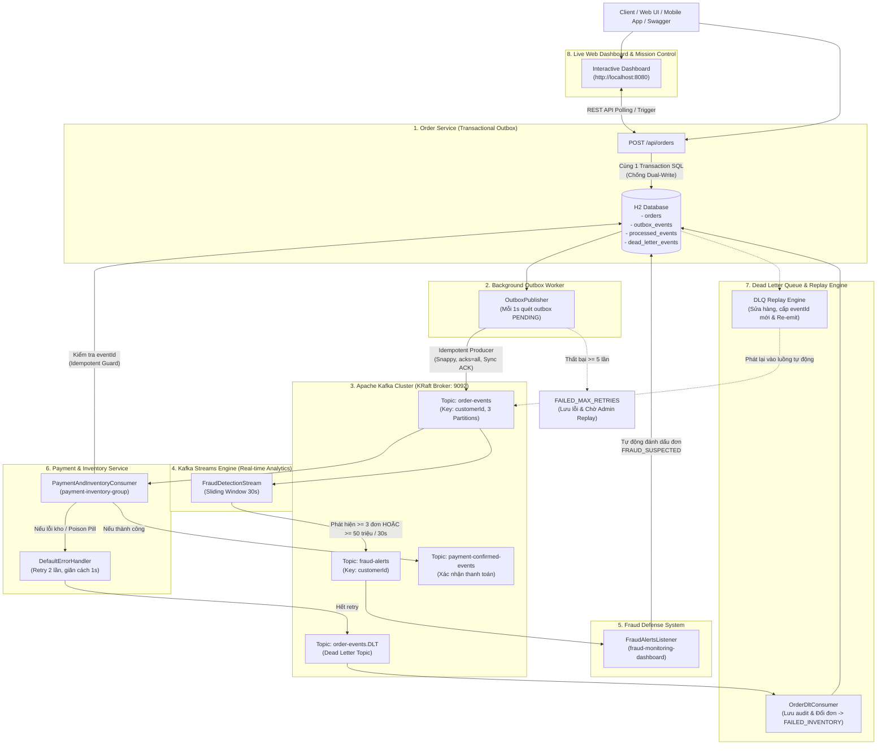

# 🛒 Hệ Thống E-Commerce Event-Driven Chuẩn Enterprise Với Apache Kafka (Phiên Bản Hoàn Thiện v2.0)

Chào mừng bạn đến với project thực chiến kiến trúc **Hệ thống Thương Mại Điện Tử & Xử Lý Sự Kiện Thời Gian Thực (Event-Driven Architecture)** chuẩn doanh nghiệp, xây dựng trên nền tảng **Spring Boot**, **Apache Kafka (KRaft)**, **Kafka Streams**, **Transactional Outbox Pattern**, **Idempotent Consumer**, **Dead Letter Queue (DLQ) & Replay Engine**, cùng **Giao diện Mission Control Web Dashboard** trực quan.

---

## 🏛️ 1. Sơ Đồ Kiến Trúc Hệ Thống Toàn Diện (System Architecture)



---

## 💎 2. Các Kỹ Thuật Đỉnh Cao Được Triển Khai Trong Bản Hoàn Thiện v2.0

| Kỹ thuật / Pattern | Vấn đề trong thực tế | Giải pháp thực tế trong project v2.0 |
| :--- | :--- | :--- |
| **Transactional Outbox Pattern** | Khi User đặt hàng, nếu ghi DB xong mà gửi Kafka bị rớt mạng $\rightarrow$ Mất dữ liệu (*Dual-Write Problem*). | Ghi Order và Outbox Event vào **cùng 1 SQL Transaction**. Outbox Publisher quét định kỳ và gửi với xác nhận ACK đồng bộ (`.get(5s)`). Nếu lỗi sẽ retry và lưu `lastError`, đạt tối đa retry sẽ chuyển sang `FAILED_MAX_RETRIES`. |
| **Idempotent Consumer** | Do Producer retry khi mất mạng, Consumer có thể nhận 1 event nhiều lần $\rightarrow$ Nguy cơ trừ tiền 2 lần. | Bảng `processed_events` lưu `eventId`. Nếu nhận lại event cũ, Consumer phát hiện và bỏ qua ngay lập tức, không trừ tiền, không xuất kho. |
| **Kafka Streams (Windowing & Analytics)** | Cần phân tích dữ liệu dòng chảy tức thì thay vì truy vấn DB truyền thống. | Khởi tạo topology Kafka Streams gom nhóm theo `customerId` trong **Cửa sổ thời gian 30 giây**. Nếu $\ge 3$ đơn hàng hoặc tổng tiền $\ge 50$ triệu VND, bắn cảnh báo thời gian thực vào topic `fraud-alerts`. |
| **Automated Fraud Defense** | Phát hiện gian lận nhưng không tự động xử lý. | `FraudAlertsListener` nhận tin từ `fraud-alerts` và ngay lập tức cập nhật trạng thái các đơn hàng của khách hàng thành `FRAUD_SUSPECTED`, bảo vệ nguồn vốn và kho hàng. |
| **Dead Letter Queue (DLQ / DLT)** | Dữ liệu lỗi hoặc sự cố kho làm kẹt partition (Poison Pill). | Cấu hình `DefaultErrorHandler` retry 2 lần (cách 1s). Nếu vẫn thất bại, tin nhắn tự động chuyển vào topic `order-events.DLT`. |
| **DLT Consumer & Audit Logging** | Message rơi vào DLT thường bị lãng quên hoặc không ai theo dõi. | `OrderDltConsumer` lắng nghe DLT, trích xuất mã đơn và thông báo lỗi, cập nhật trạng thái đơn thành `FAILED_INVENTORY` và lưu vào bảng `dead_letter_events`. |
| **DLQ Replay Engine** | Đơn hàng lỗi kho sau khi nhập thêm hàng cần được xử lý lại mà không cần khách phải đặt lại. | Hỗ trợ tính năng **Replay** 1-Click: Cập nhật thông tin hợp lệ, cấp `eventId` mới và đẩy lại vào `order-events` để tiếp tục quy trình tự động. |
| **Live Mission Control Web Dashboard** | Thiếu công cụ trực quan để theo dõi luồng sự kiện và kiểm thử kịch bản. | Giao diện Web HTML5/TailwindCSS tích hợp sẵn tại `http://localhost:8080`, hiển thị Live KPI, bảng Đơn hàng, Outbox, DLQ, Fraud Alerts và các nút thử nghiệm 1-click. |
| **OpenAPI / Swagger Documentation** | Khó tích hợp và tra cứu thông số API. | Tích hợp Springdoc OpenAPI tại `http://localhost:8080/swagger-ui.html` đầy đủ schemas, tags và request mẫu. |
| **Automated Test Suite** | Thiếu kiểm thử tự động cho kiến trúc Event-Driven. | Bộ Unit & Integration Tests tự động kiểm tra Transactional Outbox, Idempotent Consumer Guard và DLQ Replay. |

---

## 🚀 3. Hướng Dẫn Khởi Động Nhanh (Quick Start)

### Bước 1: Khởi động Cụm Apache Kafka & Kafka UI bằng Docker
Mở PowerShell tại thư mục dự án và chạy:
```powershell
docker compose up -d
```
- **Kafka Broker (KRaft)**: `localhost:9092`
- **Kafka UI (Quản trị trực quan Topics & Messages)**: [http://localhost:8085](http://localhost:8085)

### Bước 2: Chạy ứng dụng Spring Boot
```powershell
$env:JAVA_HOME = "C:\Program Files\Microsoft\jdk-11.0.16.101-hotspot"
.\mvnw.cmd spring-boot:run
```
*(Hoặc mở thư mục bằng IntelliJ IDEA / VS Code và nhấn Run file `EcommerceApplication.java`)*

---

## 🖥️ 4. Các Cổng Truy Cập Hệ Thống

| Dịch vụ | URL Truy Cập | Mục đích |
| :--- | :--- | :--- |
| 🎮 **Mission Control Web Dashboard** | [http://localhost:8080](http://localhost:8080) | **Giao diện trực quan chính**, bảng theo dõi Live Orders, Outbox, DLQ, Fraud Alerts & nút Test 1-Click |
| 📖 **Swagger / OpenAPI Documentation** | [http://localhost:8080/swagger-ui.html](http://localhost:8080/swagger-ui.html) | Tra cứu và thử nghiệm trực tiếp toàn bộ REST API |
| 📊 **Kafka UI Dashboard** | [http://localhost:8085](http://localhost:8085) | Quản trị Kafka Topics, Partitions, Consumer Groups, Offsets |
| 🗄️ **H2 SQL Database Console** | [http://localhost:8080/h2-console](http://localhost:8080/h2-console) | Tra cứu bảng SQL: `orders`, `outbox_events`, `processed_events`, `dead_letter_events`<br>*(JDBC URL: `jdbc:h2:mem:ecommercedb`, User: `sa`, Password: để trống)* |

---

## 🧪 5. Các Kịch Bản Test Thực Chiến (Có thể thao tác qua Web UI hoặc cURL)

> 💡 **Khuyến nghị**: Bạn có thể mở giao diện [http://localhost:8080](http://localhost:8080) và bấm trực tiếp các nút kịch bản để thấy dữ liệu cập nhật theo thời gian thực! Dưới đây là các lệnh cURL tương đương:

### 🟢 Kịch bản 1: Đặt Đơn Hàng Bình Thường (Transactional Outbox Pattern)
```powershell
curl -X POST http://localhost:8080/api/orders `
  -H "Content-Type: application/json" `
  -d "{\"customerId\":\"USER_VIP_01\",\"productName\":\"MacBook Pro M3 Max\",\"amount\":65000000.0,\"paymentMethod\":\"CREDIT_CARD\"}"
```
**Luồng xử lý diễn ra:**
1. API ghi Order (`PENDING`) và Outbox Event (`PENDING`) trong **cùng 1 Transaction SQL** rồi phản hồi ngay lập tức (`ACCEPTED`).
2. `OutboxPublisher` quét DB, gửi message lên Kafka topic `order-events` và nhận xác nhận ACK từ broker, sau đó cập nhật status thành `SENT`.
3. `PaymentAndInventoryConsumer` nhận message, kiểm tra bảng `processed_events`, trừ tiền, cập nhật đơn hàng thành `CONFIRMED` và phát sinh sự kiện vào topic `payment-confirmed-events`.

---

### 🚨 Kịch bản 2: Mô Phỏng Hacker SPAM Đơn Hàng (Kafka Streams Windowing & Fraud Defense)
Mô phỏng user `hacker_99` cố tình đặt liên tiếp 4 đơn hàng trong 1 giây:
```powershell
curl -X POST "http://localhost:8080/api/simulation/fraud-attack?customerId=hacker_99&count=4"
```
**Luồng xử lý diễn ra:**
1. 4 đơn hàng được đẩy vào Kafka topic `order-events`.
2. **Kafka Streams Engine**: Nhận diện trong cửa sổ Sliding Window 30s khách hàng `hacker_99` có $\ge 3$ đơn hàng.
3. Kafka Streams ngay lập tức phát sinh sự kiện cảnh báo vào topic `fraud-alerts`.
4. `FraudAlertsListener` bắt được cảnh báo, kích hoạt cơ chế phòng thủ tự động đổi trạng thái đơn hàng của user này thành `FRAUD_SUSPECTED`!
5. Kiểm tra danh sách cảnh báo thời gian thực:
```powershell
curl http://localhost:8080/api/simulation/fraud-alerts
```

---

### 💥 Kịch bản 3: Mô Phỏng Lỗi Kho / Poison Pill (Dead Letter Queue & Replay)
Gửi đơn hàng với mã sản phẩm lỗi kho:
```powershell
curl -X POST http://localhost:8080/api/simulation/dlq-poison-pill
```
**Luồng xử lý diễn ra:**
1. Consumer phát hiện mã sản phẩm `FAIL_INVENTORY_...`, ném ngoại lệ.
2. `DefaultErrorHandler` thực hiện Retry lần 1 (sau 1s) $\rightarrow$ Thất bại.
3. Thực hiện Retry lần 2 (sau 1s) $\rightarrow$ Thất bại.
4. Message tự động được chuyển sang topic `order-events.DLT`.
5. `OrderDltConsumer` lắng nghe topic DLT, ghi nhận thông tin vào bảng `dead_letter_events` và đổi trạng thái đơn hàng thành `FAILED_INVENTORY`.
6. **Thực hiện Replay đơn hỏng** (sau khi nhập thêm hàng vào kho):
```powershell
# Xem danh sách bản tin chết trong DLQ
curl http://localhost:8080/api/simulation/dlq

# Thực hiện Replay bản ghi #1 (cấp eventId mới và phát lại vào topic chính)
curl -X POST http://localhost:8080/api/simulation/dlq/replay/1
```
Đơn hàng sẽ tự động được phục hồi về `PENDING`, Consumer nhận lại và xác nhận thành công sang `CONFIRMED`!

---

### 🛡️ Kịch bản 4: Thử Nghiệm Tính Bất Biến (Idempotent Consumer Guard)
Gửi 2 tin nhắn cùng `eventId` vào Kafka để kiểm tra khả năng chống trừ tiền 2 lần:
```powershell
curl -X POST http://localhost:8080/api/simulation/idempotency-test
```
**Quan sát:**
- Message 1 được xử lý bình thường, ghi nhận vào bảng `processed_events`.
- Message 2 bị chặn lại ngay lập tức tại tầng Idempotent Guard với cảnh báo `Event ĐÃ ĐƯỢC XỬ LÝ TRƯỚC ĐÓ! Bỏ qua ngay lập tức để tránh trừ tiền 2 lần.`

---

## 📁 6. Cấu Trúc Mã Nguồn Dự Án

```
kafka-ecommerce-eventdriven/
├── docker-compose.yml             # Cụm Kafka KRaft + Kafka UI + Healthcheck
├── pom.xml                        # Spring Boot 2.7.18 + JPA + H2 + Kafka Streams + Swagger
├── README.md                      # Tài liệu hướng dẫn toàn diện
├── src/
│   ├── main/
│   │   ├── resources/
│   │   │   ├── application.yml    # Tuning Producer Snappy, Consumer, Swagger & DB
│   │   │   └── static/
│   │   │       └── index.html     # Giao diện Mission Control Web Dashboard đỉnh cao
│   │   └── java/com/example/ecommerce/
│   │       ├── EcommerceApplication.java
│   │       ├── config/
│   │       │   └── KafkaTopicAndStreamsConfig.java # Topic builder, Streams config, DLQ ErrorHandler
│   │       ├── entity/
│   │       │   ├── OrderEntity.java                # Bảng đơn hàng (hỗ trợ trạng thái mở rộng)
│   │       │   ├── OutboxEventEntity.java          # Bảng Outbox (hỗ trợ retry count & last error)
│   │       │   ├── ProcessedEventEntity.java       # Bảng Idempotency (chống duplicate)
│   │       │   └── DeadLetterEventEntity.java      # Bảng Dead Letter Queue lưu trữ bản tin hỏng
│   │       ├── repository/
│   │       │   ├── OrderRepository.java
│   │       │   ├── OutboxEventRepository.java
│   │       │   ├── ProcessedEventRepository.java
│   │       │   └── DeadLetterEventRepository.java
│   │       ├── dto/
│   │       │   ├── CreateOrderRequest.java         # DTO kèm Bean Validation
│   │       │   ├── OrderEventDTO.java              # Payload sự kiện chuẩn
│   │       │   ├── FraudAlertEvent.java            # Cảnh báo gian lận
│   │       │   ├── CustomerActivitySummary.java    # Tổng hợp dữ liệu Streams
│   │       │   └── DashboardMetricsDTO.java        # DTO tổng hợp cho Web UI
│   │       ├── service/
│   │       │   ├── OrderService.java               # Transactional Outbox implementation
│   │       │   ├── OutboxPublisher.java            # Background poller đồng bộ ACK & retry limit
│   │       │   ├── FraudDetectionStream.java       # Kafka Streams Windowing & Analytics 30s
│   │       │   ├── FraudAlertsListener.java        # Tiếp nhận Fraud Alert & Auto Lock Order
│   │       │   ├── PaymentAndInventoryConsumer.java# Idempotent Consumer & DLQ Trigger
│   │       │   ├── OrderDltConsumer.java           # DLT Consumer & Audit Error
│   │       │   └── DeadLetterQueueService.java     # Engine Replay bản tin chết
│   │       └── controller/
│   │           ├── OrderController.java            # API quản lý đơn hàng
│   │           └── SimulationAndAnalyticsController.java # API mô phỏng & Dashboard metrics
│   └── test/
│       └── java/com/example/ecommerce/service/
│           ├── OrderServiceTest.java               # Unit Test Transactional Outbox
│           ├── PaymentAndInventoryConsumerTest.java# Unit Test Idempotent Guard & DLQ Trigger
│           └── DeadLetterQueueServiceTest.java     # Unit Test DLQ Replay Engine
```

---

## 🏆 7. Chạy Kiểm Thử Tự Động (Automated Testing)

Chạy toàn bộ bộ test case tự động:
```powershell
.\mvnw.cmd test
```
**Kết quả kiểm thử:**
- `OrderServiceTest`: Kiểm chứng việc lưu Order và Outbox Event đồng thời trong 1 Transaction SQL.
- `PaymentAndInventoryConsumerTest`: Kiểm chứng việc xử lý thành công, ngăn chặn trùng lặp qua Idempotency Guard và ném lỗi kích hoạt DLQ.
- `DeadLetterQueueServiceTest`: Kiểm chứng việc sửa đổi payload, sinh eventId mới và replay lại vào topic chính.
